# SyncScore: measuring timing and pose synchronisation in dance groups from a single video

> Independent student project. It is not affiliated with, endorsed by, or connected to any
> company, label, agency or artist. The repository contains no source footage or frames, only
> derived data (keypoints, skeleton renders and plots).

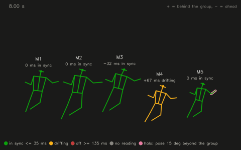

*Synthetic demo (`syncscore demo`). Only skeletons are drawn, coloured by timing: green in sync,
amber drifting, red off, grey no reading. A pink halo marks a limb whose pose differs by more
than 15°.*

## Abstract

This project asks how synchronised a dance group is, using only one ordinary video. For every
member, every 0.25 s, SyncScore estimates whether they are ahead of or behind the group, by how
many milliseconds, and which body parts are posed differently. I treat timing and shape as two
separate measurements, because a single similarity score mixes them. Timing comes from
windowed cross-correlation of bone velocities against a leave-one-out median of the other
members. Shape comes from the angle between each bone and the group median once timing has been
removed. On synthetic groups with planted offsets the per-window timing error was 0.4 ms
without noise and 3.2 ms with realistic noise. On a real 3:50 dance-practice clip, where
known delays were planted into real tracks, pooled 32 s sections recovered the delay with a
9.7 ms error and the true value fell inside the 90% interval in every case. However, only
37% of those sections produced a reading. Moment-to-moment timing on real footage remains
unsolved.

## 1. Problem

"Are they in sync?" contains two different questions:

1. Timing: is a member doing the right move at the wrong moment? I answer this in
   milliseconds, positive when behind the group and negative when ahead.
2. Shape: at the right moment, is the pose itself wrong? I answer this in degrees, per body
   part (arms, legs, torso, head) and per bone.

SyncScore answers both for every member every 0.25 s, and it reports when it cannot answer
instead of guessing.

## 2. Background: Optiqen

This work builds on [Optiqen](https://github.com/Pohthato/optiqen), my earlier badminton
analysis project, which uses the same kind of pose pipeline in a different domain. Optiqen's
worker runs Ultralytics YOLO pose on each frame, selects the athlete, gates every measurement
on keypoint confidence, and validates its geometry and hit detection against synthetic data
with known answers (`worker/geometry/synthetic.py`, `worker/evaluation/hits_benchmark.py`). It
also withdrew an earlier hit score after a harder benchmark failed to support it.

I carried over the design: a YOLO-pose front end with COCO-17 keypoints, confidence gating,
and validation against planted ground truth before trusting a number. The SyncScore code is
new, and no Optiqen code is copied. The new problem is comparing several bodies against each
other, where Optiqen compared one athlete against a court. That requires body-invariant
features, a robust group reference, and a way to separate timing from shape.

## 3. Method

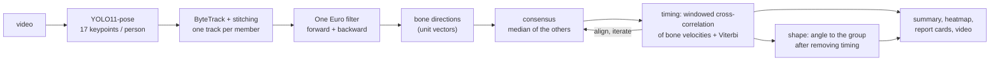

Table 1 lists each stage, what it does, and why I chose it.

| stage | implementation | rationale |
|---|---|---|
| pose | Ultralytics YOLO11-pose (`yolo11s-pose.pt`, CPU) | One pass finds every person and their COCO-17 keypoints, ByteTrack is built in, and it is the same model family as Optiqen's pose stage. RTMPose is somewhat more accurate in crowds but needs a separate detector and the MMCV stack. |
| tracking | ByteTrack followed by a stitching pass ([pose/tracks.py](syncscore/pose/tracks.py)) | The stitching rejoins members who return with a new ID after an occlusion (matched by torso colour and position), drops non-members, and flags crossings after which two tracks appear to have swapped clothes. |
| occlusion | Gaps of up to 2 s are filled with real detections only: first ones the stitching left unused, then a second, more sensitive pose pass over just the frames still missing someone ([pose/fill.py](syncscore/pose/fill.py), [pose/recover.py](syncscore/pose/recover.py)) | The detector often misses a half-hidden dancer. A filler must sit where the member should be, match their size, not belong to another member, and keep at least 6 joints of its own (joints lying on top of the front dancer's are dropped). |
| smoothing | One Euro filter, run forward and backward and averaged ([pose/smooth.py](syncscore/pose/smooth.py)) | This removes jitter while keeping fast hits (93% of peak speed). In tests a causal filter added 67 ms of lag, about the size of the offsets being measured. The two-way average cancels it (< 1 ms). |
| pose glitches | Left/right swaps that revert within 2 frames are undone; bone rotations faster than 1800°/s are marked unknown | On the real clip, 1% of frames carried about 90% of the shoulder and hip velocity energy, and all of it came from glitches. A real turn crosses the arms and they stay crossed, so a real turn is never "repaired" (this is tested). |
| body-invariant features | Bone direction unit vectors ([features/bones.py](syncscore/features/bones.py)) | A unit vector has no position, scale or length, so a tall and a short member doing the same move give identical features (tested to 1e-9). Optional mirroring (swap left/right, reflect x) handles mirrored choreography: off, per member, or automatic per window. |
| consensus | Leave-one-out median per bone ([sync/consensus.py](syncscore/sync/consensus.py)) | A member is never part of their own timing reference, and the median ignores a single other member's mistake. |
| timing | Normalised cross-correlation of bone velocities in 2 s windows every 0.25 s, searched over ±400 ms, with a parabolic sub-frame peak and Viterbi smoothing across windows ([sync/timing.py](syncscore/sync/timing.py)) | One lag per window answers the question directly. Velocity marks when moves start and stop and is insensitive to a constant pose error, which keeps timing and shape apart. I rejected dynamic time warping (DTW) because its free time-stretching absorbs part of a pose error into timing, and it gives no natural sub-frame estimate. |
| section timing | Median over many looser windows per section (default 32 s), with a 90% interval from a joint block bootstrap ([sync/sections.py](syncscore/sync/sections.py)) | On real dance a single window is weak evidence, and pooling is what held up when shifts were planted into real footage. "0 ms" remains the clip's median member even when someone is hidden. |
| group clock | Iterate: align members, rebuild the consensus, re-measure, with damping, until the change is < 0.1 ms ([sync/measure.py](syncscore/sync/measure.py)) | Offsets are relative to the median member. Without damping the estimates overshoot each other, and with 2 members they never settle. |
| shape | Angle between each bone and the whole-group median after removing timing ([sync/shape.py](syncscore/sync/shape.py)). A part counts as "off" when it is more than 15° beyond the group's own typical error at that moment. | Including the member turns the median into a vote, which stays robust in a trio. On real 2D footage, perspective and styling put everyone's arms tens of degrees from the consensus, so only standing out from the group is counted. |
| dancing together | Per member and frame: most of the visible others are dancing the same thing (limbs within a limit of each other), the member is dancing it too, and they move while the others move or hold while the others hold. The limits scale with the clip's typical difference ([sync/unison.py](syncscore/sync/unison.py)). | During a solo, split parts, or a member's own pose, the group is not a valid reference. No ghost is drawn there, and those windows do not count towards timing. |
| beat | The soundtrack is decoded with PyAV. A spectral-flux onset curve gives tempo by autocorrelation and beats by dynamic programming, and a steady half-beat grid is fitted to them ([audio/beats.py](syncscore/audio/beats.py)). Clean landings are big moves that end in stillness ([sync/landings.py](syncscore/sync/landings.py)). | The beat is displayed in the viewer for judging by eye but is not scored, because on the test clip the landings did not line up with the beat any better than chance (Section 6). |
| reliability checks | A window is reported as "no reading" when the group barely moves, the match is poor, the member is mostly unseen, or a second correlation peak is nearly as high as the first (repeated grooves) | Uncertainty is reported as uncertainty. |

The design decisions and their history are described stage by stage in
[docs/walkthrough.md](docs/walkthrough.md).

## 4. Viewer

`syncscore view path/to/video.mp4 --results results/` writes a small folder. Its `index.html`
opens in any browser without a server or installation. The page plays the video with each
member's skeleton drawn over them, coloured by their timing in that section. A pink mark
appears on any limb more than 15° beyond the group's usual difference. A thin white ghost shows
what the other members are doing at that moment, drawn on this member's body. A late dancer
therefore trails their ghost, and a wrong arm shows up as the gap between their arm and the
ghost's.

The viewer has three views. The whole-group view shows everyone at once, with a timeline of
every member by section that can be clicked to jump. The single-dancer view follows one member
and lists their worst timing moments and the pose differences they held longest beyond the
group; clicking one replays it at ¼ speed in a 2-second loop. The lineup view places everyone
side by side with their feet on one line so a move can be compared directly. Links can open the
page at a specific moment, for example
`index.html?t=62.9&view=dancer&member=M3&speed=0.25`.

Two further features depend on context. First, comparisons are only made while the group dances
together. During a solo, split parts, or a member holding their own pose while the others
dance, no ghost is drawn, a grey bar marks the stretch under their timeline row, and those
moments are excluded from timing and from the listed pose differences. Second, a beat lane
under the controls shows the beat and the "and" around the current moment, taken from the
video's soundtrack. A dot pulses on each beat, and the Sound button plays the music, including
at ¼ speed. Each dancer's clean landings appear on the lane as dots, and the dancer view lists
them with their distance from the nearest half beat. The dots are coloured as on or off the
beat only when a video's landings demonstrably line up with the beat. On the test clip they do
not, so they stay neutral and the lane is only for judging by eye.

Only detected joints are drawn. Joints that the smoothing filled in for a few frames are left
out, so nothing on screen is interpolated. The page reads the video from its original location
and never copies it, which keeps footage out of the repository. The figures below were rendered
with the video switched off.

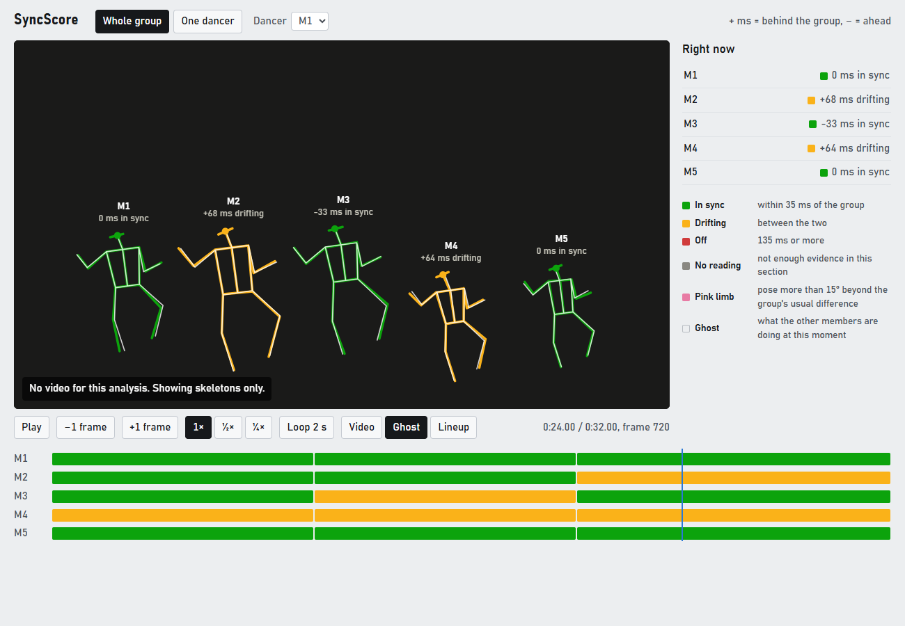

| | |
|---|---|
| 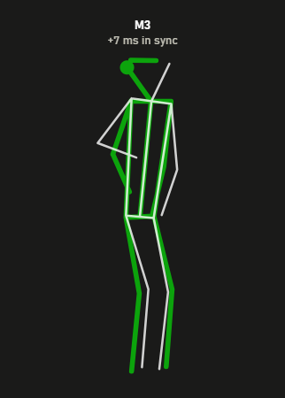 | 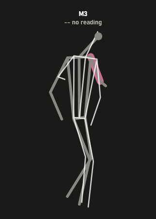 |
| *Real clip, M3 at a hit: the skeleton and the ghost overlap, apart from one arm.* | *The same moment with M3's track delayed by 133 ms: the arms trail the ghost.* |

| | |
|---|---|
| 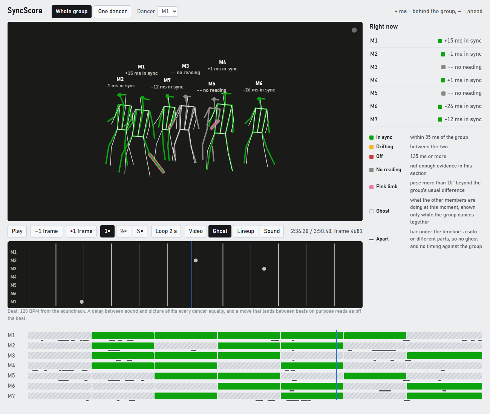 | 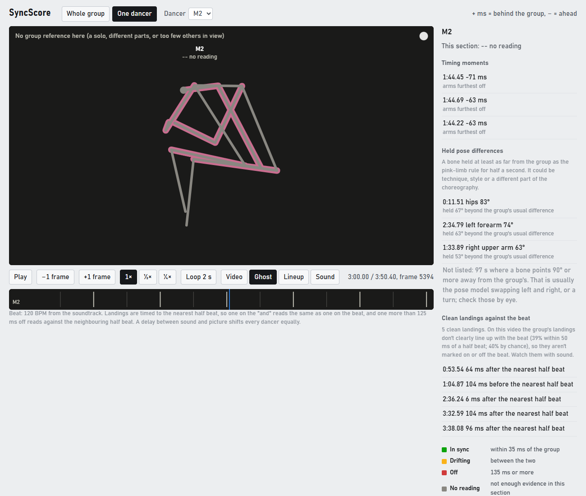 |
| *The beat lane: beats (bright) and the "and"s, each dancer's clean landings as dots, and grey bars under the timeline where a member was apart from the group.* | *M2 crouching while the others stand (3:00): no ghost and no group timing. The pink marks still show that the pose differs from the group's.* |

## 5. Evaluation

### 5.1 Synthetic benchmark

Real footage never comes with ground truth, so I tested the method on synthetic groups where
the truth is known exactly ([synth/generate.py](syncscore/synth/generate.py)). One
choreography (key poses on beats, minimum-jerk motion between them, and holds) is performed by
bodies with different heights (±18%), limb proportions (±12%) and stage positions. Each body is
shifted by an exact offset, which may be a fraction of a frame. Everything after pose
extraction runs exactly as it does on video. The benchmark is run with `syncscore validate`,
and the full tables are in [docs/validation.md](docs/validation.md).

The main test copies one dancer's motion to 7 bodies with known time shifts and known pose
errors, over 3 random choreographies. The "realistic" condition adds keypoint noise of 1% of
body height, 3% dropped keypoints, and 3° of personal style per joint.

Table 2. Recovered offsets per member.

| member | true offset | measured (clean) | measured (realistic) |
|---|---|---|---|
| M1-M3 | 0 ms | −0.1 | −0.5 to −1.7 |
| M4 | −33 ms | −33.1 | −35.2 ± 0.6 |
| M5 | +33 ms | +32.9 | +31.3 ± 0.5 |
| M6 | +67 ms | +66.9 | +64.8 ± 1.0 |
| M7 | +133 ms | +132.9 | +131.1 ± 0.7 |

Table 3. Per-window accuracy.

| | per-window error | windows measured | trusted but > 30 ms wrong |
|---|---|---|---|
| clean | 0.4 ms | 99% | 0% |
| realistic | 3.2 ms (95th pct 10 ms) | 98% | 0% |

For the planted pose errors under realistic noise, M2's left forearm (+20°) was measured at
19.0° and M6's right shin (+15°) at 14.6°. The correct bone and body part were named in 100% of
runs, while the same bone on the other members read 2.5-2.9°. M6 carried both a pose error and
a timing offset, and their timing was still measured at +64.8 ms (true value +67 ms).

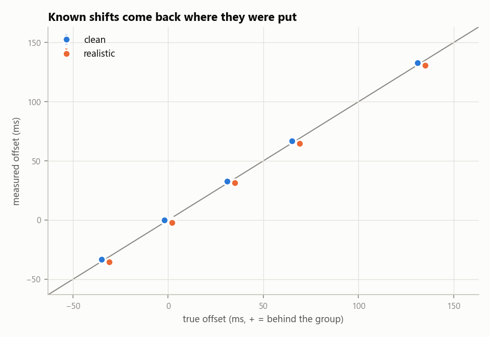

### 5.2 Failure conditions

Table 4 shows where the method breaks down (5 members, realistic noise, scored only on the
affected windows).

| condition | windows measured | error when measured | trusted but > 30 ms wrong |
|---|---|---|---|
| keypoint noise 2% / 4% of height | 95% / 42% | 4.6 / 10.1 ms | 1% / 8% |
| 10 fps (vs 30) | 98% | 5.3 ms (vs 2.6) | 0% |
| member hidden 1 s / 4 s | 62% / 33% | 4.7 / 3.8 ms | 2% / 0% |
| member leaves the frame for 10 s | 16% | 4.9 ms | 0% |
| knees and ankles cut off by the frame | 97% | 4.6 ms | 1% |
| fast spin, pose model swaps left/right for 2 of 5 members | 84% | 3.2 ms | 0% |
| groove repeating every 0.36 s (shorter than the search) | 17% | 2.7 ms | 1% |
| pose-model glitches on 2% of frames (left/right swaps, misplaced wrists), without / with glitch handling | 75% / 99% | 8.2 / 3.3 ms | 7% / 0% |
| pose error of 5° | right bone named 100%, but 4.5° vs a 2.9° floor: barely detectable | | |

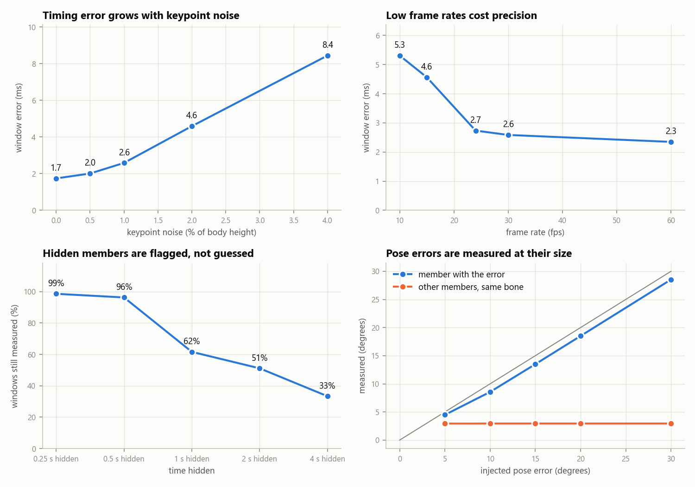

### 5.3 Real footage

The real test clip is a BTS dance practice video (3:50, 7 members). It has no answer key, so I
created one by delaying a real member's track by 33, 67 or 133 ms and repeating the measurement
(`syncscore shift-test`). This keeps the real pose noise, styling and tracking errors in the
data.

Table 5. Planted-shift results on real footage.

| | measured | error | > 30 ms wrong | truth inside the 90% interval |
|---|---|---|---|---|
| single windows, strict gates | 3% of windows | 6.3 ms | 3% | |
| single windows, 4 s long, gates loosened to 0.2 (before the tracking fix) | 23% | 14 ms | 13% | |
| 32 s sections (pooled, with intervals) | 37% of the planted members' sections | 9.7 ms | 0% | 100% |
| single hits (tried, not in the report) | 23% of hits | about 4 ms typical, 18 ms mean | 3% | |
| 32 s sections from hits | 0% | | | |
| 32 s sections, windows or hits | 37% | 9.7 ms | 0% | 100% |

These results cover 3 members × 3 shifts, after the tracking fixes described in Section 6.
Filling occlusion gaps raised the share of measured sections from 22% to 33% and the interval
coverage from 83% to 100%. M2, who previously never received a section reading, now receives one
in 14-29% of sections. Excluding windows where a member is not dancing together with the group
raised measured sections from 33% to 37%, because those windows had only added spread.

Within a window the measurement noise is roughly ±12-15 ms, but offsets across windows spread by
about ±60 ms. That spread comes from the dancing itself, either real timing variation or
styling that reads as timing. This is why a reliable answer on this clip needs about 30 s of
data.

### 5.4 A negative result: timing at the hits

I also tested whether the group's big simultaneous movements ("hits") give cleaner timing cues
than the grooving between them. For each hit, the method reads each member's speed peak within
±400 ms, to a fraction of a frame ([sync/hits.py](syncscore/sync/hits.py)). The matching
itself worked: each member's own peak followed a planted shift 99% of the time. The dancing did
not cooperate, though. At the same hit, members' peaks spread with an interquartile range of
45-100 ms, and a 32 s section held only 0-8 matched hits per member. No section built from hits
reached an interval narrower than 50 ms, and adding hits to the window-based sections added at
most one member-section. The report therefore uses window sections only. `syncscore shift-test`
still scores the hits so that this result can be reproduced. Stage B of
[docs/walkthrough.md](docs/walkthrough.md) describes the experiment in full.

### 5.5 Scope of these results

These numbers measure the method after pose extraction. They do not measure the pose model or
the tracker on real dancers. Synthetic motion is smoother than real dance, which particularly
flatters low frame rates. The synthetic noise is Gaussian, whereas real keypoint errors are
correlated, biased by clothing and hair, and largest during fast motion. Real accuracy is
bounded by the pose model.

## 6. Limitations

- Members facing a different way. When both a member's shoulder line and hip line point opposite
  to the group's (because they face away, or the pose model swapped their left and right), their
  pose cannot be compared in 2D. Those frames are excluded from pose errors and reported as a
  share, so they do not appear as 180° "errors".
- 2D measurement. Bone directions are measured in the image plane. Members turned at different
  angles to the camera show slightly different directions for the same 3D pose, which reads as
  shape error. Lifting to 3D would address this, at the cost of a second model with its own
  errors.
- The group as reference. Offsets are relative to the median member. If most of the group is
  late against the music, the timing does not show it.
- The beat is shown but not scored. The music's grid is reliable (on the test clip, 120 BPM with
  87% of tracked beats within 40 ms of a steady grid), but the dancers' side is not. Their clean
  landings fell within 50 ms of a half beat 38.5% of the time, against a chance rate of 40%. Only
  the very biggest moves leaned towards the beat in an earlier test (55-59%, about ten per dancer
  across the whole song), far too few to time anyone by (docs/walkthrough.md, Stage F). Most
  choreography is not hit-and-hold, and a 2D landing at 30 fps cannot be located to within tens
  of milliseconds. A delay between sound and picture would shift every dancer equally. Offsets
  are measured to the nearest half beat, so a landing on the "and" reads the same as one on the
  beat, and a landing more than 125 ms off (at 120 BPM) is measured against the neighbouring half
  beat.
- Dancing together is judged in 2D. A canon (the same move performed in turn) and individual
  parts read as apart, which is intended. Members dancing the same move while facing very
  different directions can also read as apart.
- Repeated grooves faster than ±400 ms are inherently ambiguous: a member one full cycle late
  looks on time. These windows are flagged rather than scored.
- ID swaps between members in matching outfits are not reliably detected by the colour
  heuristic. Measuring the true swap rate requires the manual audit (`syncscore audit`).
- With only two members, the method can say that they differ but never which one is wrong.
- Shape errors read about 5% too small, because the member is part of their own shape reference.
  This is the cost of robustness in small groups. Errors below about 5° are at the noise floor.
- Real footage needs long sections. On the test clip a trustworthy timing answer needs about
  30 s per member, and only a third to a half of member-sections receive one. Moment-to-moment
  timing on real dance is not solved here. Timing at the group's big hits did not help, because
  members' peaks spread about as widely at the hits as their timing does during grooving.
- Style versus timing. A dancer who styles a move differently can read as early or late. The
  planted-shift test shows that the measurement responds correctly to timing changes, but it
  cannot separate real timing variation from styling.
- Tracking on the test clip. ByteTrack produced 159 IDs for 7 people. The stitching originally
  discarded 15% of the member detections, because it treated long pieces with poor colour
  matches as passers-by. After the fix, 96% are kept, from 99 rejoined pieces. Filling occlusion
  gaps with real detections raised the share of frames with all 7 members tracked from 46.5% to
  57.1%, and each member is visible 76-96% of the time. Gaps longer than 2 s are left empty.
  Identity errors at crossings are still possible: there are 39 suspected swaps, up from 19
  before gap filling, and all 20 new ones are at crossings the check could not see while those
  frames were gaps. The true rate requires the manual audit.
- Before the occlusion fix, section intervals were slightly overconfident on real footage (83%
  coverage for a claimed 90%). After the fix, coverage was 100% in the planted test, although
  this rests on only 9 plants.
- The thresholds (35 ms "in sync", 135 ms "off", 15° "pose off") are my choices, not
  established standards.

## 7. Reproducing the results

A CPU is sufficient, although slow. A CUDA build of torch makes pose extraction much faster.

```bash
python -m venv .venv
.venv/Scripts/pip install -r requirements.txt -e .   # on macOS/Linux: .venv/bin/pip
```

```bash
syncscore demo --out results/demo                 # synthetic group through every output
syncscore validate --out results/validate         # the benchmark above (a few minutes, runs in parallel)
syncscore analyze path/to/video.mp4 --out results/   # real video
syncscore view path/to/video.mp4 --results results/  # the viewer: open results/viewer/index.html
syncscore shift-test --results results/               # plant known delays in real tracks, check they come back
syncscore audit path/to/video.mp4 --results results/ # sample frames to label IDs by hand
syncscore audit-score results/audit/ids.csv          # true ID-swap rate
pytest                                             # unit tests for the alignment math and the synthetic recovery
```

Beat detection needs PyAV (`pip install av`, included in requirements.txt). Without it, or for a
video with no soundtrack, `view` still writes the viewer and the page explains why there is no
beat lane.

`analyze` writes `summary.json` and `summary.csv` (per member and per section: offset with a 90%
interval, share of sections in sync, strict single-window moments, and the body part most often
off), `heatmap.png`, `report_cards/`, `skeletons.mp4`, `smoothing_example.png`,
`tracking_report.json` and the derived keypoints. The first run downloads the pose weights
(about 20 MB). Settings are in [configs/default.yaml](configs/default.yaml), where sections can
also be defined by timestamps.

Synthetic demo. The known answers are: M2 drifts from 0 to +120 ms after 16 s, M3 is 33 ms early,
M4 is 67 ms late, and M5's left elbow is 25° off from 6 to 14 s. Sections are 10 s long.

| | |
|---|---|
| 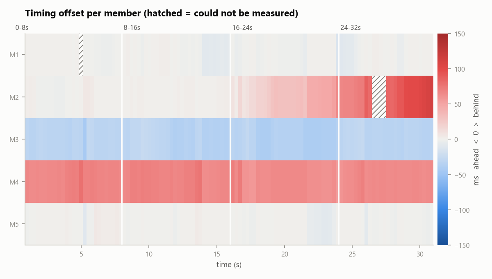 | 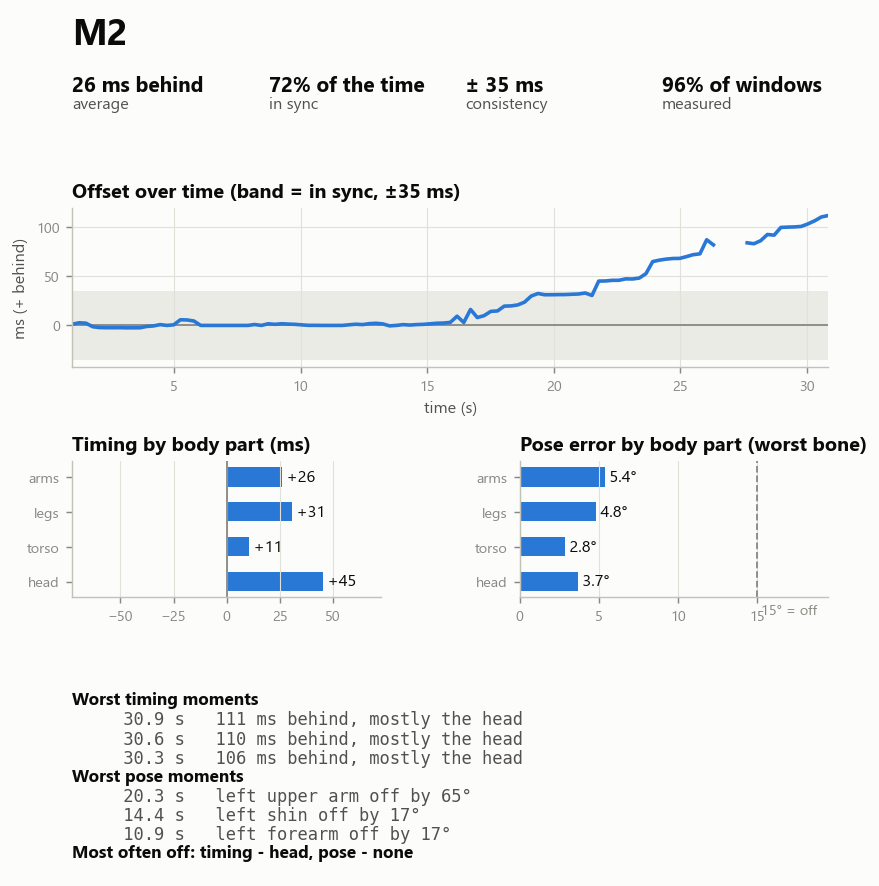 |
| *Heatmap: each cell is one member in one section, with its 90% interval.* | *Report card: M2's drift appears in the last section.* |

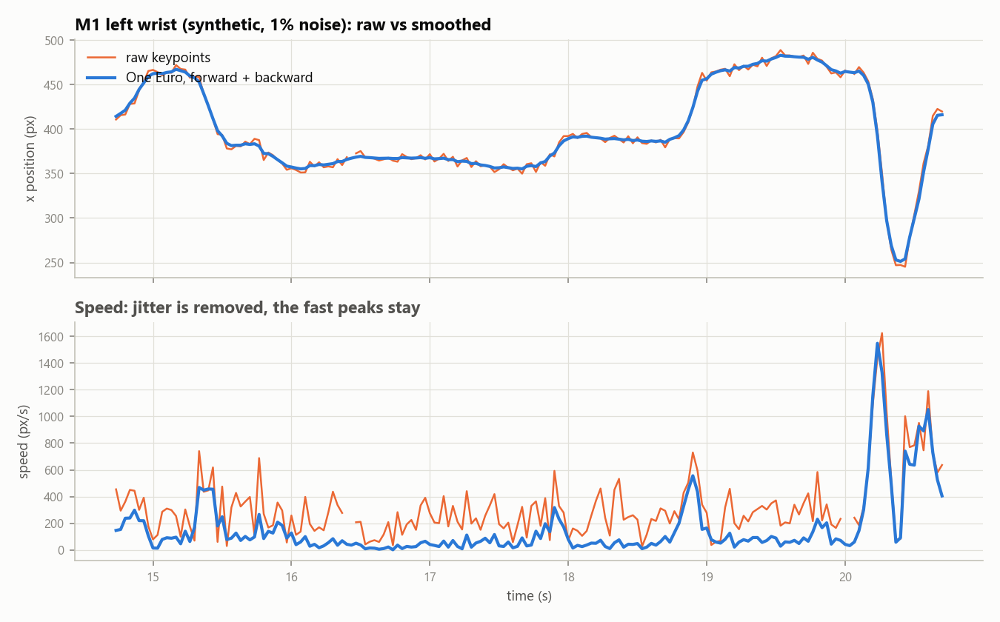

Real clip (BTS dance practice, 32 s sections; derived skeletons and plots only, no footage):

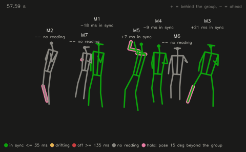

| | |
|---|---|
| 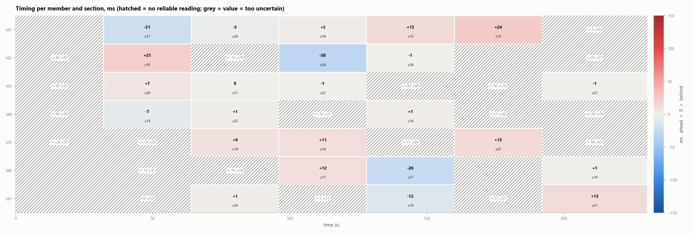 | 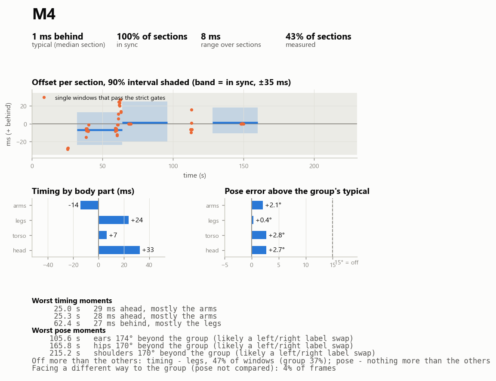 |
| *Hatched cells have no reliable reading; grey cells were measured but are too uncertain to state. Every member who could be measured is within about ±30 ms of the group.* | *Pose errors are shown relative to the group's own spread. Bone errors near 180° are flagged as likely left/right label swaps.* |

## 8. Repository layout

```
syncscore/
  pose/      extract.py (YOLO11-pose + ByteTrack), tracks.py (stitching, swaps, audit), smooth.py, video.py
  features/  bones.py (bone directions, mirroring)
  sync/      consensus.py, timing.py, shape.py, measure.py (the method), summary.py
  synth/     generate.py (synthetic groups), benchmark.py, report.py
  viz/       skeleton_video.py, heatmap.py, report_card.py, smoothing_plot.py, style.py,
             ghost.py, viewer_data.py, viewer/ (the page: index.html, viewer.js, viewer_core.js, viewer.css)
  cli.py, pipeline.py, outputs.py, config.py
configs/default.yaml
tests/       alignment math, synthetic recovery, smoothing, tracking, outputs, viewer (js/ runs in Node)
docs/        walkthrough.md, validation.md, media/ (derived renders only)
```

## 9. Data and copyright

Source videos and frames are never committed. `.gitignore` blocks every video format as well
as `data/`, `frames/` and `results/`. The audit command writes labelled frames for local
inspection, and they stay in `results/`. Only derived data (keypoints, skeleton-only renders and
plots) is published, under `docs/media/`.
