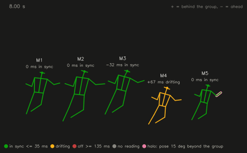
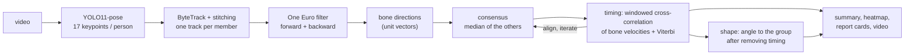
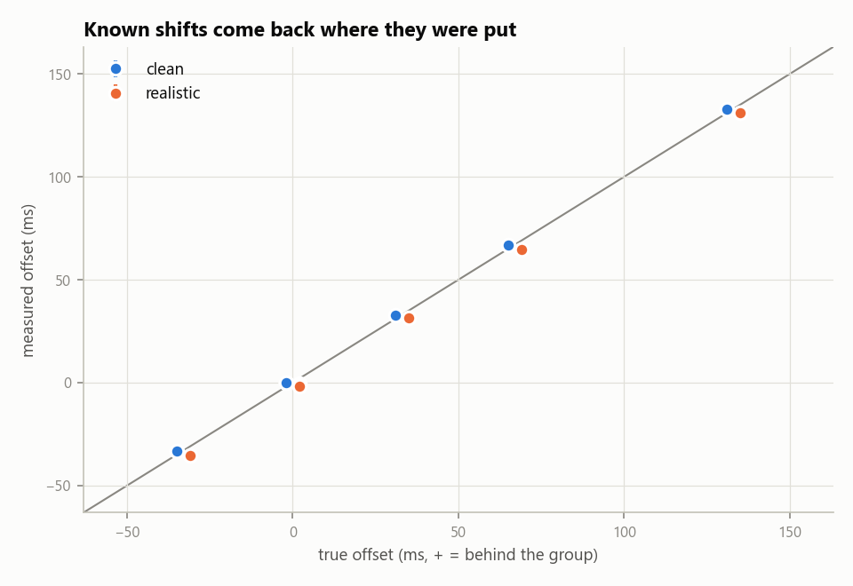
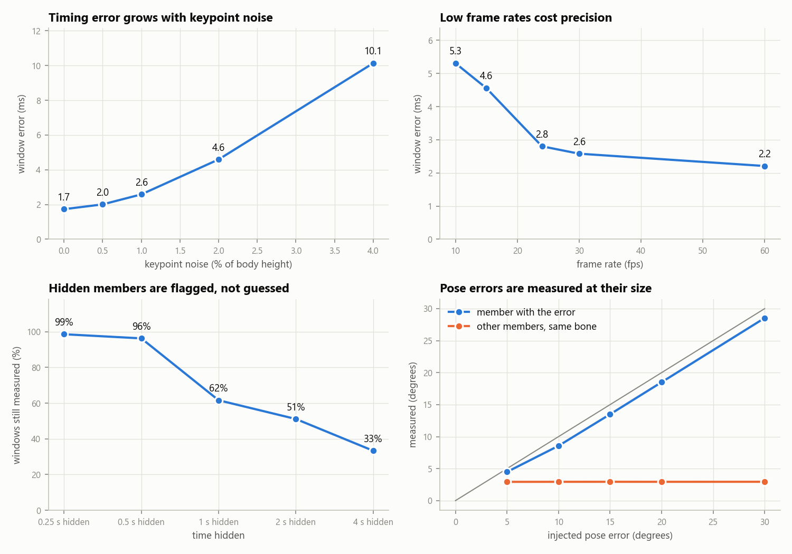
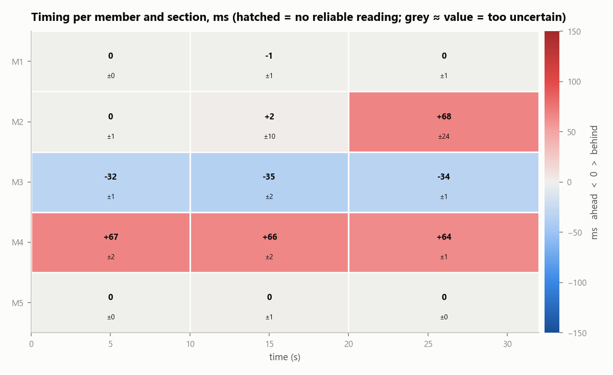
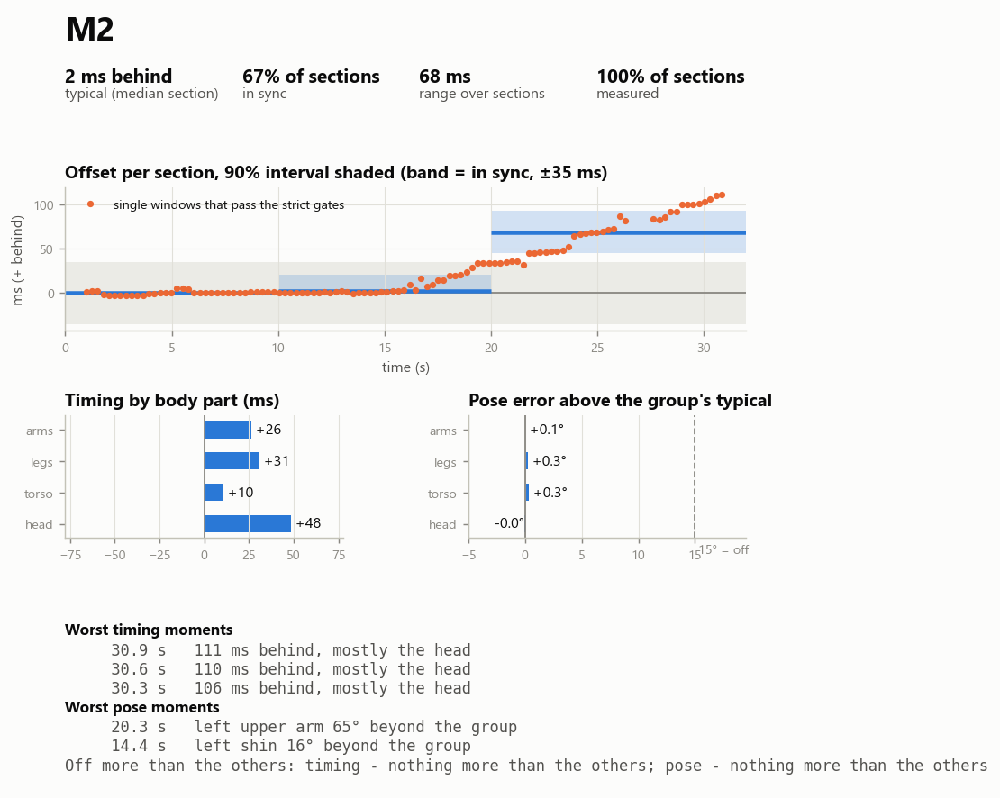
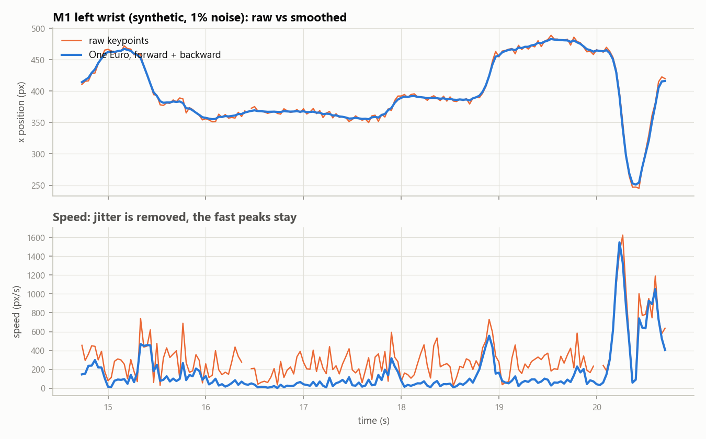
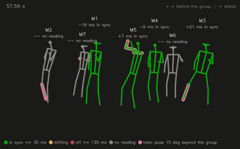
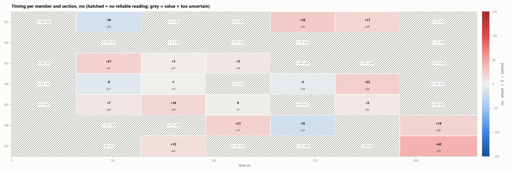
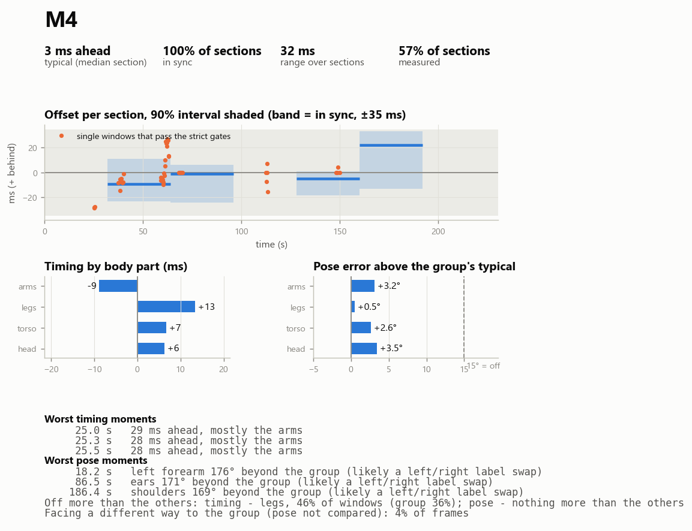

# SyncScore

Measures how synchronized a dance group is from a single video: frame by frame, which member
is ahead or behind, on which body part, and by how much.

> Independent student project. Not affiliated with, endorsed by, or connected to any company,
> label, agency or artist. No source footage or frames are stored in this repository; only
> derived data (keypoints, skeleton renders and plots) is.



*Synthetic demo (`syncscore demo`): skeletons only, coloured by timing (green in sync, amber
drifting, red off, grey no reading). The pink halo marks a limb whose pose is off by more than 15°.*

## The question

"Are they in sync?" is really two questions, and a single similarity score mixes them up:

1. **Timing:** is a member doing the right move at the wrong moment? Answer in milliseconds,
   + behind and − ahead of the group.
2. **Shape:** at the right moment, is the pose wrong? Answer in degrees, per body part (arms,
   legs, torso, head) and per bone.

SyncScore answers both separately, for every member, every 0.25 s, and says when it cannot
answer.

## Method



| step | what | why |
|---|---|---|
| pose | Ultralytics **YOLO11-pose** (`yolo11s-pose.pt`, CPU) | one pass finds every person and their COCO-17 keypoints; ByteTrack is built in; same family as Optiqen's pose stage. RTMPose is somewhat more accurate in crowds but needs a separate detector and the MMCV stack. |
| tracking | **ByteTrack**, then a stitching pass ([pose/tracks.py](syncscore/pose/tracks.py)) | rejoins members who come back with a new ID after an occlusion (by torso colour and position), drops non-members, flags crossings after which two tracks look like they swapped clothes. |
| smoothing | **One Euro filter**, run forward and backward and averaged ([pose/smooth.py](syncscore/pose/smooth.py)) | removes jitter while keeping fast hits (93% of peak speed). A causal filter added 67 ms of lag in tests, as big as the offsets being measured; the two-way average cancels it (< 1 ms). |
| pose glitches | left/right swaps that **revert within 2 frames** are undone; bone turns faster than 1800°/s are marked unknown | on the real clip, 1% of frames carried ~90% of the shoulder and hip velocity energy, all glitches. A real turn crosses the arms and stays crossed, so it is never "repaired" (tested). |
| comparable bodies | **bone direction unit vectors** ([features/bones.py](syncscore/features/bones.py)) | a unit vector has no position, scale or length, so a tall and a short member doing the same move are identical (tested to 1e-9). Optional **mirroring** (swap left/right, reflect x) for mirrored choreography: off, per member, or auto per window. |
| consensus | **leave-one-out median** per bone ([sync/consensus.py](syncscore/sync/consensus.py)) | a member is never part of their own timing reference, and a median ignores one other member's mistake. |
| timing | **normalised cross-correlation of bone velocities**, 2 s windows every 0.25 s, ±400 ms, parabolic sub-frame peak, Viterbi over windows ([sync/timing.py](syncscore/sync/timing.py)) | one lag per window is exactly the question. Velocity marks when moves start and stop and is blind to a constant pose error, which keeps timing and shape apart. DTW was rejected: its free time-stretching absorbs part of a pose error into timing, and it gives no natural sub-frame estimate. |
| section timing | median of many looser windows per section (default 32 s), with a 90% interval from a joint block bootstrap ([sync/sections.py](syncscore/sync/sections.py)) | on real dance single windows are weak witnesses, and pooling is what holds up when shifts are planted into real footage. "0 ms" stays the clip's median member even when someone is hidden. |
| group clock | iterate: align members, rebuild consensus, re-measure, damped, until < 0.1 ms change ([sync/measure.py](syncscore/sync/measure.py)) | offsets are relative to the **median member**. Without damping the estimates overshoot each other (with 2 members, forever). |
| shape | angle between each bone and the **whole-group median** after removing timing ([sync/shape.py](syncscore/sync/shape.py)); a part is "off" when it is more than 15° beyond the **group's own typical error** at that moment | including the member makes the median a vote, which stays robust in a trio. On real 2D footage perspective and styling put everyone's arms tens of degrees from the consensus, so only standing out from the group counts. |
| honesty gates | a window is "no reading" when the group barely moves, the match is poor, the member is mostly unseen, or **a second correlation peak is nearly as high** (repeated grooves) | not knowing is reported as not knowing. |

The full reasoning, stage by stage, is in [docs/walkthrough.md](docs/walkthrough.md).

## Validation

Real footage never comes with the truth, so the method is tested on synthetic groups where it
is known exactly ([synth/generate.py](syncscore/synth/generate.py)). One choreography (key poses
on beats, minimum-jerk motion, holds) is performed by bodies with different heights (±18%),
limb proportions (±12%) and stage positions, each shifted by an exact, even sub-frame, offset.
Everything after pose extraction runs exactly as on video. Run it with `syncscore validate`.
The full tables are in [docs/validation.md](docs/validation.md).

**The requested test:** one dancer's motion copied to 7 bodies, shifted by known amounts, with
known pose errors (3 random choreographies each; "realistic" adds 1%-of-height keypoint noise,
3% dropped keypoints and 3° of personal style per joint).

| member | true offset | measured (clean) | measured (realistic) |
|---|---|---|---|
| M1-M3 | 0 ms | −0.1 | −0.5 to −1.7 |
| M4 | −33 ms | −33.1 | −35.2 ± 0.6 |
| M5 | +33 ms | +32.9 | +31.3 ± 0.5 |
| M6 | +67 ms | +66.9 | +64.8 ± 1.0 |
| M7 | +133 ms | +132.9 | +131.1 ± 0.7 |

| | per-window error | windows measured | trusted but > 30 ms wrong |
|---|---|---|---|
| clean | 0.4 ms | 99% | 0% |
| realistic | 3.2 ms (95th pct 10 ms) | 98% | 0% |

Planted pose errors, realistic: M2's left forearm +20° measured **19.0°** and M6's right shin
+15° measured **14.6°**, with the right bone and body part named in 100% of runs and the same
bone on the other members at 2.5-2.9°. M6 had both errors, and their timing was still measured at +64.8 ms (true +67).



**Where it fails** (5 members, realistic noise, scored on the affected windows):

| condition | windows measured | error when measured | trusted but > 30 ms wrong |
|---|---|---|---|
| keypoint noise 2% / 4% of height | 95% / 42% | 4.6 / 10.1 ms | 1% / 8% |
| 10 fps (vs 30) | 98% | 5.3 ms (vs 2.6) | 0% |
| member hidden 1 s / 4 s | 62% / 33% | 4.7 / 3.8 ms | 2% / 0% |
| member leaves the frame for 10 s | 16% | 4.9 ms | 0% |
| knees and ankles cut off by the frame | 97% | 4.6 ms | 1% |
| fast spin, pose model swaps left/right for 2 of 5 members | 84% | 3.2 ms | 0% |
| groove repeating every 0.36 s (shorter than the search) | 17% | 2.7 ms | 1% |
| pose-model glitches on 2% of frames (left/right swaps, misplaced wrists), without / with glitch handling | 75% / 99% | 8.2 / 3.3 ms | 7% / 0% |
| pose error of 5° | right bone named 100%, but 4.5° vs a 2.9° floor: barely detectable | | |



**On real footage** (BTS dance practice, 3:50, 7 members). There's no answer key, so one is
planted: a real member's track is delayed by 33 / 67 / 133 ms and the measurement is repeated
(`syncscore shift-test`). This keeps the real pose noise, styling and tracking errors in.

| | measured | error | > 30 ms wrong | truth inside the 90% interval |
|---|---|---|---|---|
| single windows, strict gates | 3% of windows | 7.0 ms | 4% | |
| single windows, 4 s long, gates loosened to 0.2 (before the tracking fix) | 23% | 14 ms | 13% | |
| **32 s sections** (pooled, with intervals) | 19% of the planted members' sections | 11.7 ms | 0% | 83% (claimed 90%: slightly overconfident) |

(3 members × 3 shifts; after the tracking fix below. One member, M2, never gets a section reading,
even with a planted shift: their timing varies too much from section to section to state a
number, and the tool says so instead.)

Per window the measurement noise is about ±12-15 ms, but window offsets spread about ±60 ms,
and that spread comes from the dancing (real timing variation, or styling read as timing). That's
why a reliable answer needs about 30 s on this clip.

**What these numbers do and don't say.** They measure the *method* after pose extraction.
They don't measure the pose model or tracker on real dancers. Synthetic motion is smoother than
real dance, which flatters low frame rates in particular. Noise here is Gaussian; real
keypoint errors are correlated, biased by clothing and hair, and worst exactly at fast motion.
Real accuracy is bounded by the pose model.

## Limitations

- **Facing a different way.** When a member's shoulder and hip lines both point the opposite way
  to the group's (they face away, or the pose model swapped their left and right), their pose
  can't be compared in 2D. Those frames are left out of pose errors and reported as a share,
  instead of showing up as 180° "errors".
- **2D only.** Bone directions are measured in the image. Members turned at different angles
  to the camera show slightly different directions for the same 3D pose, which reads as shape
  error. Lifting to 3D would fix this at the cost of a second model with its own errors.
- **Reference = the group.** Offsets are relative to the median member. If most of the group is
  late against the music, that is invisible. Audio beat alignment is not implemented.
- **Repeated grooves** faster than ±400 ms are fundamentally ambiguous: a member one full cycle
  late looks on time. These windows are flagged, not scored.
- **ID swaps between members in matching outfits** are not reliably detected by the colour
  heuristic; the real swap rate needs the hand audit (`syncscore audit`).
- **Two members:** the method can say that they differ, never who is wrong.
- **Shape errors read about 5% small**, because the member is part of their own shape reference
  (the price of robustness in small groups). Errors under about 5° are at the noise floor.
- **Real footage needs long sections.** On the test clip a trustworthy timing answer needs about
  30 s per member, and only a third to half of member-sections get one. Moment-to-moment timing
  on real dance is not solved here.
- **Style or timing?** A dancer who styles a move differently can read as early or late. The
  planted-shift test proves the measurement responds correctly to timing changes, but it can't
  separate real timing variation from styling.
- **Tracking on the test clip:** ByteTrack gave 159 IDs for 7 people. The stitching first threw
  away 15% of the member detections (it treated long, badly colour-matched pieces as passers-by);
  after the fix 96% are kept and every member is visible 72-93% of the time, from 99 rejoined
  pieces. Identity errors at crossings are still possible: 19 suspected swaps, and the true rate
  needs the hand audit.
- **Section intervals are slightly overconfident on real footage** (83% coverage for a claimed 90%).
- Thresholds (35 ms "in sync", 135 ms "off", 15° "pose off") are choices, not standards.

## Built on Optiqen

SyncScore builds on [Optiqen](https://github.com/Pohthato/optiqen), my badminton analysis
project: the same pose pipeline in a different domain. Optiqen's worker runs Ultralytics YOLO
pose per frame, selects the athlete, gates every measurement on keypoint confidence, and
validates its geometry and hit detection against synthetic data with known answers
(`worker/geometry/synthetic.py`, `worker/evaluation/hits_benchmark.py`). It also withdrew an
earlier hit score when a harder benchmark didn't support it.

What carries over is the design: the YOLO-pose front end with COCO-17 keypoints, confidence
gating, and validating against planted ground truth before trusting a number. The SyncScore
code itself is new; no Optiqen code is copied. What's new is the domain problem: comparing
*several* bodies against each other instead of one athlete against a court, which needs
body-invariant features, a robust group reference, and separating timing from shape.

## Running it

CPU is enough (slow is fine); a CUDA build of torch makes pose extraction much faster.

```bash
python -m venv .venv
.venv/Scripts/pip install -r requirements.txt -e .   # on macOS/Linux: .venv/bin/pip
```

```bash
syncscore demo --out results/demo                 # synthetic group through every output
syncscore validate --out results/validate         # the benchmark above (a few minutes, runs in parallel)
syncscore analyze path/to/video.mp4 --out results/   # real video
syncscore shift-test --results results/               # plant known delays in real tracks, check they come back
syncscore audit path/to/video.mp4 --results results/ # sample frames to label IDs by hand
syncscore audit-score results/audit/ids.csv          # true ID-swap rate
pytest                                             # unit tests for the alignment math and the synthetic recovery
```

`analyze` writes `summary.json` / `summary.csv` (per member and per section: offset with a 90%
interval, share of sections in sync, strict single-window moments, body part most often off), `heatmap.png`, `report_cards/`,
`skeletons.mp4`, `smoothing_example.png`, `tracking_report.json` and the derived keypoints. The
first run downloads the pose weights (about 20 MB). Settings live in
[configs/default.yaml](configs/default.yaml); sections can be set there by timestamps.

**Synthetic demo** (known answers: M2 drifts from 0 to +120 ms after 16 s, M3 is 33 ms early,
M4 67 ms late, M5's left elbow is 25° off from 6 to 14 s; 10 s sections):

| | |
|---|---|
|  |  |
| *Heatmap: each cell is one member in one section, with its 90% interval.* | *Report card: M2's drift appears in the last section.* |



**Real clip** (BTS dance practice, 32 s sections; derived skeletons and plots only, no footage):



| | |
|---|---|
|  |  |
| *Hatched = no reliable reading; grey ≈ values were measured but too uncertain to state. Every member who could be measured sits within about ±30 ms of the group.* | *Pose errors are shown relative to the group's own spread; bone errors near 180° are flagged as likely left/right label swaps.* |

## Layout

```
syncscore/
  pose/      extract.py (YOLO11-pose + ByteTrack), tracks.py (stitching, swaps, audit), smooth.py, video.py
  features/  bones.py (bone directions, mirroring)
  sync/      consensus.py, timing.py, shape.py, measure.py (the method), summary.py
  synth/     generate.py (synthetic groups), benchmark.py, report.py
  viz/       skeleton_video.py, heatmap.py, report_card.py, smoothing_plot.py, style.py
  cli.py, pipeline.py, outputs.py, config.py
configs/default.yaml
tests/       alignment math, synthetic recovery, smoothing, tracking, outputs
docs/        walkthrough.md, validation.md, media/ (derived renders only)
```

## Copyright and data

Source videos and frames are never committed: `.gitignore` blocks every video format,
`data/`, `frames/` and `results/`. The audit command writes labelled frames for you to look at
locally; they stay in `results/`. Only derived data (keypoints, skeleton-only renders, plots)
is published, under `docs/media/`.
